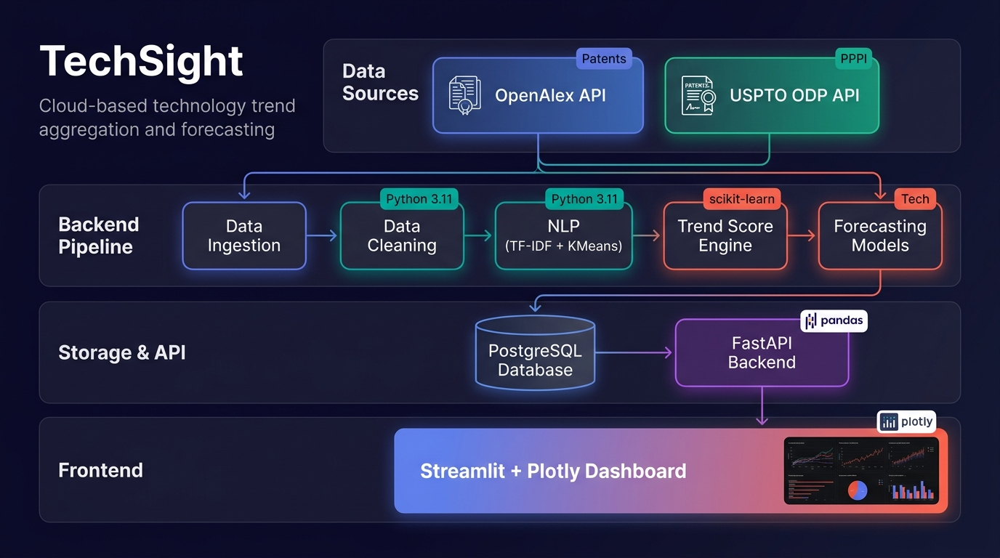
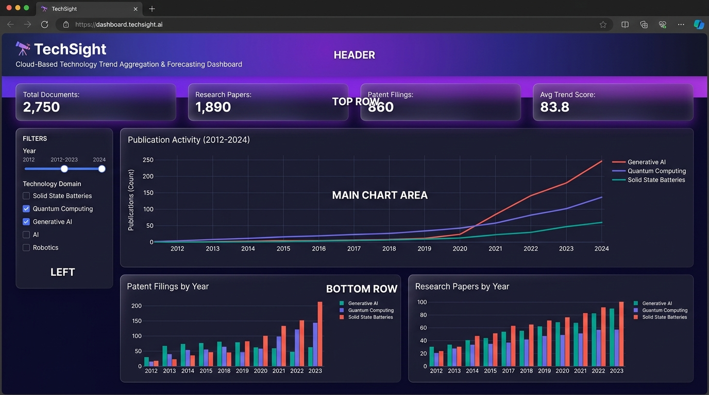
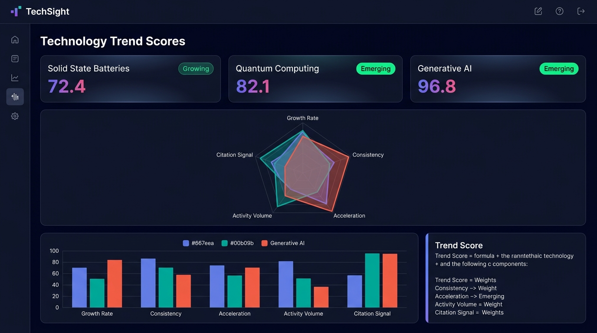
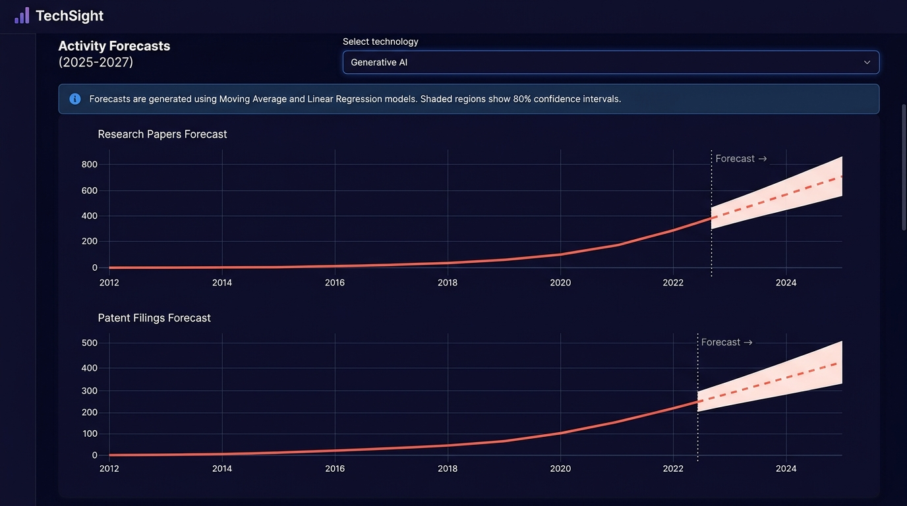

# TechSight 🔭

**Cloud-Based Technology Trend Aggregation and Forecasting Dashboard
Using Public Patent and Research Data**

> **AI Track:** NLP + Data Analytics | **Domain:** Technology Intelligence

---

## 📋 Project Description

### Problem Statement

Researchers, investors, and policymakers need to track emerging technology
trends across patents and academic research — but this data is scattered
across multiple sources (USPTO, OpenAlex), in different formats, and
requires significant expertise to analyze. There is no unified, accessible
tool that aggregates this data, discovers technology topics automatically,
and provides explainable trend forecasts.

### Target Users

- **Researchers** — Track which technology areas are growing fastest
- **Technology Scouts** — Identify emerging technologies before competitors
- **Policy Makers** — Data-driven evidence for R&D funding decisions
- **Students & Academics** — Understand technology landscape evolution

### Technical Approach

TechSight implements a **6-stage data pipeline**:

1. **Data Ingestion** — Collects patent (USPTO) and research paper (OpenAlex) metadata
2. **Data Cleaning** — Normalizes, deduplicates, and integrates records into a common schema
3. **NLP Topic Discovery** — Uses TF-IDF vectorization + KMeans clustering to automatically discover technology topics
4. **Trend Score Computation** — Calculates a weighted composite score (0–100) with 5 explainable components
5. **Forecasting** — Predicts future activity using Moving Average and Linear Regression models with evaluation metrics
6. **Visualization** — Interactive Streamlit + Plotly dashboard with real-time filtering

### Technologies & Components

| Layer | Technology |
|---|---|
| Language | Python 3.11 |
| Data Processing | pandas, numpy |
| NLP | scikit-learn (TF-IDF, KMeans, cosine similarity) |
| Forecasting | Moving Average, scikit-learn LinearRegression |
| Backend API | FastAPI, uvicorn, Pydantic |
| Database | PostgreSQL 16, psycopg2, parameterized SQL |
| Frontend | Streamlit, Plotly |
| Testing | pytest |

### Real-World Impact

- **Democratizes technology intelligence** — Makes patent/research trend data accessible to non-experts
- **Explainable AI** — Every Trend Score component has clear, documented formulas (no black-box predictions)
- **Cross-source insights** — Uniquely combines patent AND research data to give a fuller picture than either source alone
- **Actionable forecasts** — Predictions with confidence intervals help users understand uncertainty

---

## 📸 Screenshots

### Architecture Diagram


### Dashboard — Trend Overview


### Dashboard — Trend Scores


### Dashboard — Forecasts


---

## 🔭 Technology Domains Analyzed

| Domain | Key Topics | Trend Status |
|---|---|---|
| **Solid-State Batteries** | Solid electrolyte, lithium, garnet, sulfide | 📈 Growing (72.4) |
| **Quantum Computing** | Qubit, error correction, entanglement | 🚀 Emerging (82.1) |
| **Generative AI** | LLM, transformer, diffusion, fine-tuning | 🚀 Emerging (96.8) |

---

## 🚀 Quick Start

### 1. Clone and set up environment

```bash
git clone https://github.com/yashvanthkanna-s/TECHSIGHT.git
cd TECHSIGHT
python -m venv venv
venv\Scripts\activate        # Windows
pip install -r requirements.txt
```

### 2. Run the full pipeline

```bash
python run_pipeline.py
```

This runs all 6 stages (ingestion → cleaning → NLP → trend scores → forecasting)
and prints results to the console. Works out-of-the-box with mock data.

### 3. Start the API

```bash
uvicorn api.main:app --reload --port 8000
```

API docs available at: `http://localhost:8000/docs`

### 4. Start the Dashboard

```bash
streamlit run dashboard/app.py
```

Dashboard available at: `http://localhost:8501`

### 5. Run Tests

```bash
pytest tests/ -v
```

---

## 📁 Project Structure

```
TECHSIGHT/
├── config.py                  # All tunable parameters
├── run_pipeline.py            # Main pipeline runner (6 stages)
├── requirements.txt           # Python dependencies
├── schema.sql                 # PostgreSQL schema (8 tables)
├── ingestion/                 # Data connectors
│   ├── openalex_connector.py  #   OpenAlex API (research papers)
│   └── uspto_connector.py     #   USPTO ODP API (patents)
├── processing/
│   └── cleaner.py             # Data cleaning & integration
├── nlp/
│   └── topic_model.py         # TF-IDF + KMeans topic discovery
├── analytics/
│   └── trend_score.py         # Composite Trend Score (0–100)
├── forecasting/
│   └── models.py              # Moving avg, linear regression, evaluation
├── database/
│   └── connection.py          # PostgreSQL helper (parameterized queries)
├── api/
│   └── main.py                # FastAPI backend (REST endpoints)
├── dashboard/
│   └── app.py                 # Streamlit + Plotly dashboard
├── tests/
│   └── test_pipeline.py       # pytest test suite (15 tests)
├── mock/
│   ├── mock_data.py           # Realistic synthetic data generator
│   └── README.md
├── docs/
│   ├── design_decisions.md    # Architectural decision records
│   ├── trend_score.md         # Trend Score formula documentation
│   ├── dev_log.md             # Development diary
│   ├── architecture_diagram.jpg
│   ├── dashboard_screenshot.jpg
│   ├── trend_scores_screenshot.jpg
│   └── forecast_screenshot.jpg
└── data/                      # Raw and processed data (gitignored)
```

---

## 🧮 Trend Score Formula

The Trend Score (0–100) combines five weighted components:

| Component | Weight | What it measures |
|---|---:|---|
| Growth Rate | 35% | CAGR of total activity over lookback period |
| Consistency | 25% | Fraction of years with positive YoY growth |
| Acceleration | 20% | Whether growth is speeding up or slowing down |
| Activity Volume | 10% | Log-scaled total activity level |
| Citation Signal | 10% | Citation trend direction |

**Labels:** Emerging (75–100) · Growing (55–75) · Stable (40–55) · Declining (0–40)

---

## 📖 Documentation

- [Design Decisions](docs/design_decisions.md) — Why we made key choices
- [Trend Score](docs/trend_score.md) — Formula definitions and edge cases
- [Dev Log](docs/dev_log.md) — Team development diary

---

## ⚠️ Limitations

- Patent data has publication and indexing delays; recent years may be incomplete
- Only ~13 yearly data points (2012–2024) per topic — thin for forecasting
- KMeans clusters on text data are approximate, not scientifically validated categories
- Trend Score is a heuristic, not a peer-reviewed metric
- This is a student project, not a commercial forecasting platform

---

## 👥 Team

- Built as a 5th-semester engineering mini-project
- Three-member team guided by staged development methodology

## 📄 License

Academic project — not licensed for commercial use.
